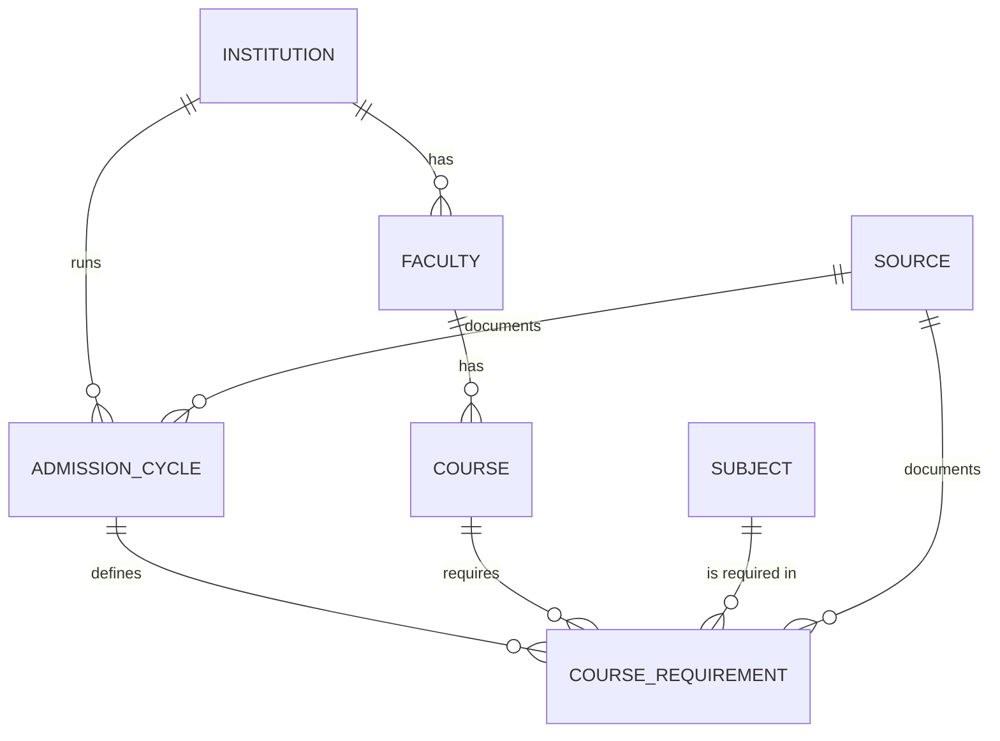

# Domínio académico (módulo `academics`)

Estado: proposta aceite, ainda sem código. As decisões estão registadas no [ADR 0006](adr/0006-modelo-do-dominio-academico.md).

## O que o módulo responde

- Que instituições, faculdades e cursos existem?
- Que disciplinas exige cada curso num dado concurso de acesso?
- Que cursos exigem Física no concurso de 2026/2027?
- O que mudou de um ano para o outro?
- De onde vem cada informação, e já foi verificada?

## Conceitos

| Conceito (nome no código) | O que é |
|---|---|
| Instituição (`Institution`) | Universidade ou instituição de ensino superior |
| Faculdade (`Faculty`) | Pertence a uma instituição |
| Curso (`Course`) | Pertence a uma faculdade |
| Disciplina (`Subject`) | Catálogo único e partilhado: Matemática, Física, Língua Portuguesa... |
| Concurso de acesso (`AdmissionCycle`) | Uma instituição num ano letivo, por exemplo 2026/2027 |
| Exigência (`CourseRequirement`) | Num concurso, um curso exige uma disciplina, com um peso opcional |
| Fonte (`Source`) | Documento de onde vem a informação: edital, programa oficial, site da instituição |

## Relações

## Proveniência (origem e verificação)

Os dados que descrevem a realidade (instituições, faculdades, cursos, concursos e exigências) levam estes campos:

- origem: `oficial` ou `demonstração`
- fonte (opcional, mas obrigatória nos dados verificados)
- estado de verificação: `por verificar` ou `verificado`
- data da verificação

O catálogo de disciplinas não leva proveniência, porque "Matemática" não é um dado oficial de uma instituição.

## Regras que os testes vão garantir

1. O curso de uma exigência pertence à mesma instituição do concurso.
2. Não há duas exigências iguais (mesmo concurso, curso e disciplina).
3. Um dado verificado tem origem oficial e tem fonte.
4. Dados de demonstração nunca ficam verificados.
5. O estudante só vê como oficial o que é de origem oficial e está verificado. O que é demonstração aparece identificado como tal.

## Fora deste módulo

Programas curriculares, temas, aulas, exercícios e provas anteriores ficam em `content`, `exercises` e `exams`, e ligam-se às disciplinas por referência ao catálogo.

## Questões em aberto

- Como classificar as instituições (públicas e privadas) e a sua província, se for útil para filtrar.
- Se uma disciplina tem variantes (por exemplo, Matemática I e II) ou é sempre uma só.
- Se o peso de cada disciplina na nota é uma regra geral ou específica de cada curso (o modelo suporta o segundo caso).
- Que dados reais recolher primeiro, e de que editais. Estes dados são recolhidos pelo dono do projeto a partir de documentos oficiais e não são inventados.
