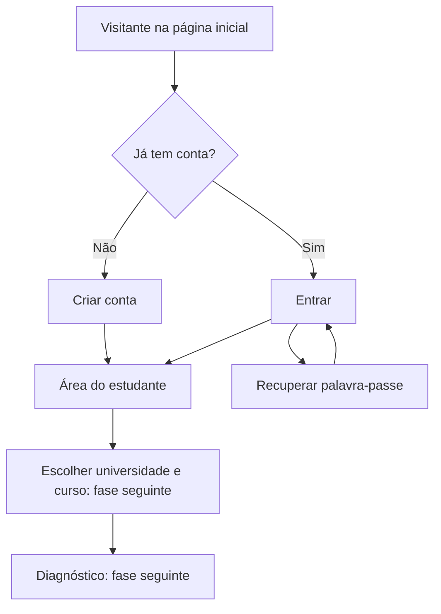

# Fluxos e wireframes (Fase 3)

Estado: proposta, a validar antes de escrever as páginas. Os wireframes são esboços de estrutura, sem cores nem tipografia final: essas vêm do [sistema de design](design-system.md).

Os textos de exemplo são honestos: a plataforma ainda não tem aulas, simulados nem professor, e as páginas dizem-no. Nada é apresentado como disponível antes de existir.

## Percurso do estudante



Nesta fase constroem-se a página inicial, o registo, a entrada, a recuperação de palavra-passe e a área do estudante. As etapas seguintes do percurso (escolher curso, diagnóstico, plano de estudo) ficam para as fases 4 a 8.

## Navegação

- Visitante: "Preparatório" (liga à página inicial), "Entrar" e "Criar conta".
- Estudante com sessão iniciada: "Preparatório" (liga à área do estudante) e "Sair".
- Rodapé discreto, com o estado do projeto e, quando a demonstração está ligada, o aviso "Dados de demonstração".

## Página inicial

Telemóvel (o desenho principal, porque é onde a maioria vai usar):

```text
+------------------------------------+
| Preparatório               Entrar  |
+------------------------------------+
|                                    |
| Prepara-te para o exame de         |
| acesso à universidade.             |
|                                    |
| Plataforma de estudo para          |
| estudantes angolanos. Em           |
| desenvolvimento: ainda não há      |
| aulas nem simulados.               |
|                                    |
| [ Criar conta ]                    |
|                                    |
+------------------------------------+
| O que vai existir                  |
|                                    |
| 1  Escolher universidade e curso   |
|    Em desenvolvimento              |
| 2  Diagnóstico dos teus            |
|    conhecimentos                   |
|    Em desenvolvimento              |
| 3  Plano de estudo                 |
|    Em desenvolvimento              |
| 4  Aulas e exercícios              |
|    Em desenvolvimento              |
| 5  Professor com IA, também        |
|    por voz                         |
|    Em desenvolvimento              |
| 6  Simulados e provas anteriores   |
|    Em desenvolvimento              |
+------------------------------------+
```

Computador: o conteúdo ocupa duas colunas assimétricas, com o texto à esquerda e a lista à direita. Sem cartões.

```text
+----------------------------------------------------------------------+
| Preparatório                                    Entrar   Criar conta |
+----------------------------------------------------------------------+
|                                          O que vai existir           |
| Prepara-te para o exame de                                           |
| acesso à universidade.                   1  Escolher universidade    |
|                                             e curso                  |
| Plataforma de estudo para                2  Diagnóstico              |
| estudantes angolanos. Em                 3  Plano de estudo          |
| desenvolvimento: ainda não há            4  Aulas e exercícios       |
| aulas nem simulados.                     5  Professor com IA         |
|                                          6  Simulados e provas       |
| [ Criar conta ]   Entrar                                             |
|                                          Tudo em desenvolvimento.    |
+----------------------------------------------------------------------+
```

A lista "O que vai existir" reflete a visão do produto. Cada item diz "Em desenvolvimento" enquanto não existir, e deixa de o dizer quando existir.

## Criar conta

```text
+------------------------------------+
| Preparatório               Entrar  |
+------------------------------------+
|                                    |
| Criar conta                        |
|                                    |
| Nome de utilizador                 |
| [                              ]   |
| Letras, números e @ . + - _        |
|                                    |
| Email                              |
| [                              ]   |
| Serve para recuperares a           |
| palavra-passe.                     |
|                                    |
| Palavra-passe                      |
| [                              ]   |
| Pelo menos 8 caracteres. Não       |
| pode ser só números nem uma        |
| palavra-passe comum.               |
|                                    |
| Confirmar palavra-passe            |
| [                              ]   |
|                                    |
| [ Criar conta ]                    |
|                                    |
| Já tens conta? Entrar              |
+------------------------------------+
```

Um erro aparece junto do campo, com texto e ícone (a cor nunca é a única pista):

```text
+------------------------------------+
| Nome de utilizador                 |
| [ allem                        ]   |
| (!) Erro: este nome já existe.     |
|     Escolhe outro.                 |
+------------------------------------+
```

## Entrar

```text
+------------------------------------+
| Preparatório         Criar conta   |
+------------------------------------+
|                                    |
| Entrar                             |
|                                    |
| Nome de utilizador                 |
| [                              ]   |
|                                    |
| Palavra-passe                      |
| [                              ]   |
|                                    |
| [ Entrar ]                         |
|                                    |
| Esqueci a palavra-passe            |
| Ainda não tens conta? Criar conta  |
+------------------------------------+
```

## Área do estudante

```text
+------------------------------------+
| Preparatório                 Sair  |
+------------------------------------+
|                                    |
| Olá, allem.                        |
|                                    |
| Ainda não escolheste a             |
| universidade e o curso.            |
|                                    |
| [ Escolher curso ]  (em breve)     |
|                                    |
+------------------------------------+
| Universidades                      |
|                                    |
| Ainda não há universidades         |
| verificadas na plataforma.         |
|                                    |
| Com a demonstração ligada, os      |
| dados aparecem com a etiqueta      |
| "Dados de demonstração".           |
+------------------------------------+
```

Em produção, enquanto não houver dados verificados, esta página mostra o aviso vazio e nada mais, como decidido no [ADR 0009](adr/0009-visibilidade-dos-dados-para-o-estudante.md).

## Regras comuns de acessibilidade

- Ligação "Saltar para o conteúdo" como primeiro elemento focável.
- Um só título principal (`h1`) por página, e uma hierarquia de títulos sem saltos.
- Todos os campos têm rótulo visível, e nunca apenas um texto de exemplo dentro do campo.
- Os atributos `autocomplete` certos (`username`, `email`, `new-password`, `current-password`).
- Foco visível, alvos de toque de 44x44px, navegação completa por teclado.
- Mensagens de erro ligadas ao campo (`aria-describedby`) e anunciadas a quem usa leitores de ecrã.

## Questões em aberto

- Recuperar a palavra-passe exige enviar emails. No desenvolvimento escrevem-se no terminal, mas em produção precisamos de um serviço de email. Tem de ser gratuito (regra de custos) e confiável, e a escolha fica para o passo da autenticação.
- Aceitar também o email como nome de entrada, em vez de só o nome de utilizador.
- Proteção de dados: rever os requisitos legais, o consentimento e a idade mínima antes de recolher dados de estudantes reais.
- Verificar o email ao criar a conta, ou aceitar sem verificação nesta fase.
